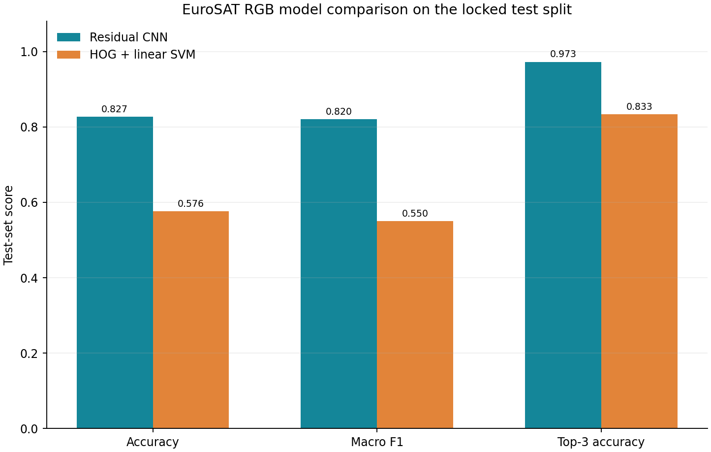
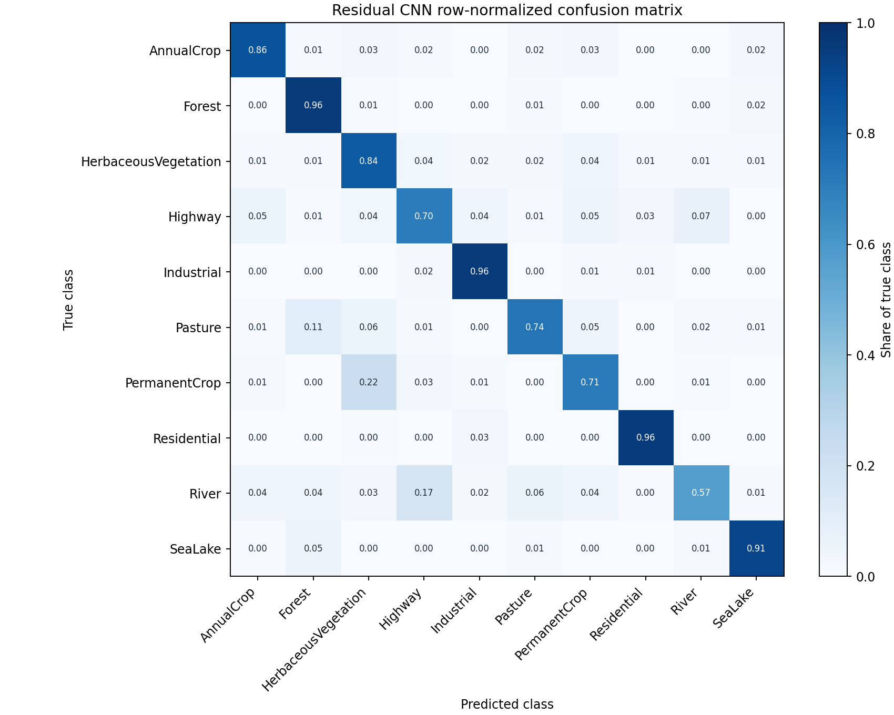
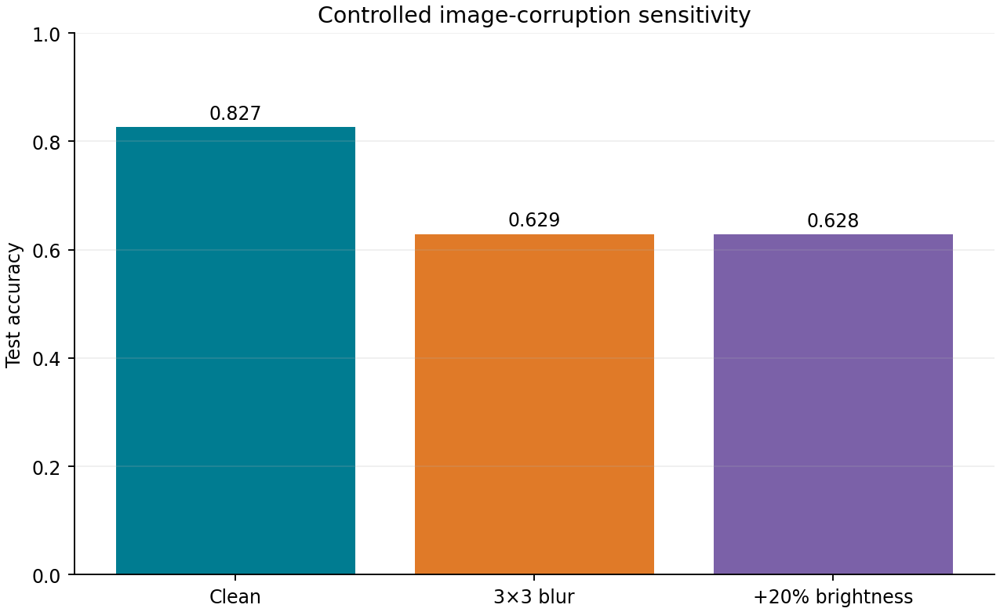

# EuroSAT land-cover classification results

## Study question

Can a compact image model classify EuroSAT RGB land-cover patches, where does it fail, and how sensitive is it to mild image corruption?

## Data and split

- Official EuroSAT RGB v2 archive: 27,000 valid 64×64 RGB images across 10 classes.
- Archive SHA-256: `b4f5b234ecb7d7ff9c6cddb046543b4717c53fd6e9815be6c0e80cc614f51b90`; exact duplicate image copies: 0.
- Duplicate-group-aware split: 18,897 train, 4,053 validation, 4,050 locked test images.

## Locked test performance

| Model | Accuracy (95% CI) | Macro F1 (95% CI) | Balanced accuracy | Top-3 accuracy | Brier score |
|---|---:|---:|---:|---:|---:|
| Residual CNN | 0.827 (0.815, 0.837) | 0.820 (0.807, 0.831) | 0.821 | 0.973 | 0.261 |
| HOG + linear SVM | 0.576 (0.563, 0.589) | 0.550 (0.536, 0.562) | 0.560 | 0.833 | not estimated |

The residual CNN selected epoch 4 by validation macro F1. Its test accuracy is 82.691% (95% class-stratified bootstrap CI 81.493% to 83.741%); macro F1 is 81.991%.

## Error analysis

The lowest-F1 classes are:

| Class | Precision | Recall | F1 | Support |
|---|---:|---:|---:|---:|
| River | 0.829 | 0.567 | 0.674 | 402 |
| Highway | 0.697 | 0.704 | 0.701 | 382 |
| PermanentCrop | 0.747 | 0.711 | 0.729 | 357 |
| Pasture | 0.805 | 0.735 | 0.769 | 321 |
| HerbaceousVegetation | 0.726 | 0.836 | 0.777 | 469 |

Largest off-diagonal confusions:

- PermanentCrop predicted as HerbaceousVegetation: 80 images.
- River predicted as Highway: 70 images.
- Pasture predicted as Forest: 35 images.
- Highway predicted as River: 28 images.
- River predicted as Pasture: 26 images.

## Controlled robustness checks

| Test condition | Accuracy | Macro F1 |
|---|---:|---:|
| Clean RGB | 0.827 | 0.820 |
| 3×3 mild blur | 0.629 | 0.585 |
| +20% brightness | 0.628 | 0.608 |

These controlled corruptions are stress checks, not a domain-generalization evaluation. Confidence intervals are class-stratified bootstrap intervals on the fixed test split; they do not include split or training-seed uncertainty.

## Interpretation limits

EuroSAT RGB contains anonymized, geographically sampled image patches. The random stratified split does not establish performance on a new region, time, sensor, or spatially separated map tile. Some classes are visually similar and the study does not weight class mistakes by operational cost. The app and API are benchmark demos, not land-cover mapping products. Dataset attribution and terms are recorded in [NOTICE.md](../NOTICE.md).
